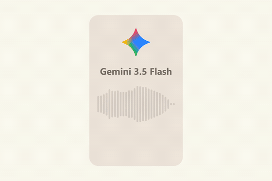
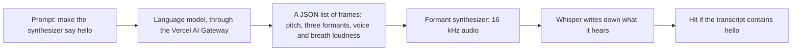

<h1 align="center">Say Hello</h1>

<b>Ten language models try to make a speech synthesizer say "hello".</b> 
No audio and no tools. Each one writes the numbers that shape the sound, and Whisper says what it heard.

  

## How it works

1. **Prompt.** Each model is told it controls a formant synthesizer and must answer with a JSON list of frames: how long each lasts, the voice pitch, the first three formants (the resonances of the mouth that make one vowel sound different from another), and how loud the buzz of the voice and the hiss of breath are. Nothing else. The full prompt is in [`sayhello/ask.py`](sayhello/ask.py).
2. **Synthesize.** A small cascade formant synthesizer, written for this repo, turns the frames into 16 kHz audio. A pulse train makes the voice, noise makes the breath, and both run through three moving resonators.
3. **Listen.** Whisper (`small.en`) transcribes every clip. A try counts when the word hello is in what it wrote down.
4. **Repeat.** Ten models, three tries each, all asked through the Vercel AI Gateway with the same prompt.

## System design

The model never hears anything and never runs code. Its whole answer is a list of numbers, and everything after that is fixed.

## Results

Three tries per model, 30 clips. A hit means Whisper wrote down hello.

| Model | Heard as hello | Mean Whisper confidence |
|---|---:|---:|
| Llama 3.1 8B | 0 of 3 | 0.41 |
| gpt-oss-20b | 0 of 3 | 0.47 |
| Qwen3 32B | 0 of 3 | 0.40 |
| Llama 3.3 70B | 0 of 3 | 0.36 |
| DeepSeek V4 Pro | **3 of 3** | 0.45 |
| Kimi K3 | **3 of 3** | 0.40 |
| Gemini 3.5 Flash | **3 of 3** | **0.51** |
| GPT-5.5 | **3 of 3** | 0.45 |
| Claude Haiku 5.5 | **3 of 3** | 0.43 |
| Claude Opus 5.5 | **3 of 3** | 0.49 |

The split is clean: the four smaller or older open models missed every try, and the six frontier models hit every try. What Whisper heard instead:

| Model | Try 1 | Try 2 | Try 3 |
|---|---|---|---|
| Llama 3.1 8B | "Mmmmm" | "uuuuuuuuuu" | "Oh" |
| gpt-oss-20b | "BAM" | "Well y'all" | "Got it" |
| Qwen3 32B | a two word swear | "Go ahead." | "BLEH-EH-EH" |
| Llama 3.3 70B | "Bleh." | "BLEH BLEH" | "Wha- Wha-" |

Confidence is Whisper's mean token probability. It only separates the six models that all hit, and only by a little, so treat the order among them as loose. Gemini 3.5 Flash opens the video because it ranked first by that fixed rule, picked before the video was made.

Some honest limits:

- **Three tries is a small sample.** The split between the two groups held on all 30 clips, but the confidence order among the six frontier models could easily change on a rerun.
- **Hello is an easy word.** It is short, common, and probably shows up in phonetics teaching material, so a model may have read formant values for it. Harder words and full sentences are the obvious next test.
- **Not every model here is text only.** Some frontier models are trained on audio as well as text. None of them got to listen to this synthesizer or run code; the answer is numbers written in one go.
- **Whisper is a generous listener.** It is trained to find words in noisy speech. A person might hear some hits as a robot clearing its throat.

**Checking the synthesizer first.** Before asking any model, a hello written by hand from textbook formant values ([`frames/reference.json`](frames/reference.json)) had to come out as hello. The first version drove the formants with a smooth pulse and Whisper heard "Who", then "Pooh". [`scripts/vowel_check.py`](scripts/vowel_check.py) showed why: on a held "eh", the second formant came out 30 dB under the first, so every vowel sounded like "oo". Switching to an impulse train brought it to 14.5 dB under, about where real speech sits, and the hand-written hello was heard as hello. Every model was run on that fixed version.
